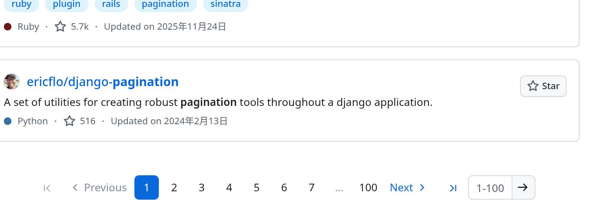
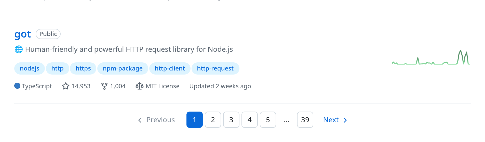
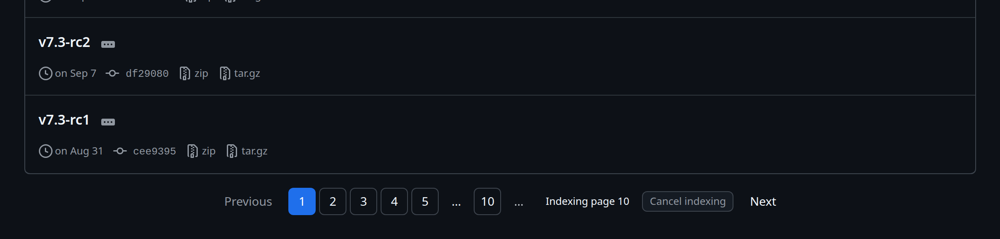
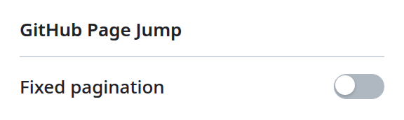

# ⏭️ GitHub Page Jump

**English** | [简体中文](README.zh-CN.md)

A zero-build Chrome Manifest V3 extension that adds first-page, last-page, and
direct page-jump controls to GitHub pagination — including the cursor-based
(Previous / Next) lists that ship without page numbers.

[](https://github.com/TekkenSteve/github-page-jump/actions/workflows/ci.yml)
[](LICENSE)

| Numbered paginators (search results)                                                                       | Numberless lists (`?tab=repositories`)                                                          |
| ---------------------------------------------------------------------------------------------------------- | ----------------------------------------------------------------------------------------------- |
|  |  |

| Cursor lists, mid-index (dark theme)                                                                                       | Toolbar popup                                                                     |
| -------------------------------------------------------------------------------------------------------------------------- | --------------------------------------------------------------------------------- |
|  |  |

All screenshots come from the extension's own source code running on real
GitHub pages.

## ✨ Features

- ⏮️ **First page** and ⏭️ **last page** buttons on paginators that show page numbers.
- 🔢 **Type a page number and press Enter** to jump straight to it.
- 📄 A page-number window (`1 2 3 … n`) on lists that hide their page numbers,
  indexed automatically in the background while you read the list and inserted
  between GitHub's own Previous and Next, which stay untouched — sequential
  navigation is GitHub's, the window only adds direct jumps.
- 🔗 Works on both numberless list shapes GitHub serves today:
  `page`-parameter lists (profile `?tab=repositories`, `?tab=followers`) and
  opaque `after`-cursor lists (`?tab=stars`, `/tags`, `/commits`), including
  the last page of a cursor chain, which carries no `after=` link at all.
- 📌 **Fixed pagination** preference that pins the paginator to the bottom of
  the viewport, toggled from the toolbar popup (off by default).
- 🌗 Controls are built from GitHub's Primer color variables, so they follow
  GitHub's light, dark, and high-contrast themes automatically.
- 🔁 Survives GitHub's partial navigation (Turbo and PJAX).
- ♿ Accessible controls: real buttons, GitHub's own `Page N` naming
  convention, `aria-current="page"`, inline validation messages, and a live
  progress status.

## 📋 Requirements

- Chrome 116 or newer (any Chromium-based browser with Manifest V3 support
  should work; only Chrome is tested).

## 📦 Install

From source (developer mode):

1. Open `chrome://extensions/`.
2. Enable **Developer mode** (top right).
3. Click **Load unpacked** and select this folder (the one with `manifest.json`).

From a release:

1. Download `github-page-jump-v<version>.zip` from the
   [releases](https://github.com/TekkenSteve/github-page-jump/releases) page.
2. Unzip it anywhere, then load the unzipped folder as described above.

After installing or upgrading, refresh GitHub tabs that were already open —
content scripts only inject on page load.

## 🔍 How it works

GitHub renders three usable pagination shapes, and the extension picks the
matching strategy per list:

| Shape            | Example                               | Jumping to page N                               | Finding the last page                                                                      |
| ---------------- | ------------------------------------- | ----------------------------------------------- | ------------------------------------------------------------------------------------------ |
| Numbered links   | Search results                        | Instant — reuses GitHub's own links             | Instant — the numbers are already there                                                    |
| `page` parameter | `?tab=repositories`, `?tab=followers` | Instant — rewrites `?page=N`, **zero requests** | Exponential scan + binary search, ≈ `2·log₂(pages)` requests (4 pages ≈ 4, 100 pages ≈ 13) |
| `after` cursor   | `?tab=stars`, `/tags`, `/commits`     | Walks the cursor chain, one request per page    | Walks the chain to its end                                                                 |

For the two numberless shapes the extension inserts one generic number window
between GitHub's own Previous and Next and indexes the list by itself, starting
as soon as the list renders — not when you click. The numbers grow as the window
learns about them, so most pages are already plain links by the time you reach
for them. Sequential navigation stays on GitHub's own links, in GitHub's own
wording.

- The cursor walk is throttled to one request every 120 ms and capped at 300
  hops; progress ("Indexing page 7" / "Probing page 4") is shown inline and can
  be cancelled at any time.
- The window only renders page numbers it can already open; for the remainder,
  GitHub's native Next is one click away while the walk catches up.
- Discovered cursors and totals are cached in `sessionStorage` for 30 minutes,
  so later jumps in that tab resolve instantly.
- Network or parse failures never leave the page broken — the window shows an
  error message and GitHub's native controls keep working.

Lists that already show page numbers keep the numeric controls, and lists with
a single page get no controls at all.

## 🔒 Permissions and privacy

The extension runs only on `https://github.com/*` and requests only the
`storage` permission, used to remember the fixed-pagination preference. On
numberless lists it fetches the same list pages from `github.com` itself —
same-origin, with the session cookies already in your browser — to read the
next cursor or page number out of the markup. Nothing is sent anywhere else
and nothing is collected. See [PRIVACY.md](PRIVACY.md).

## 🩺 Troubleshooting

Run this in the console of a GitHub tab to see what the extension detected:

```js
GitHubPageJumpController.report();
```

Each entry names the paginator root, the host that received controls, the
detected strategy (`numeric`, `page`, `cursor`, or `null`), and how many
control groups were injected. An empty array means no paginator matched;
`mode: null` means a paginator was found but offered no jumpable link.

Other common situations:

- **No controls after installing** — refresh the tab (see [Install](#-install)).
- **Numbers grow while the window indexes** — that is the background walk; the
  window only renders numbers it can already open, GitHub's native Next covers
  the remainder, and "Cancel indexing" stops the walk.
- **A list shows fewer pages than expected** — the walk is capped at 300 hops;
  on longer lists the pager keeps working for the pages it has reached.

## ❓ FAQ

- **Why does the extension make network requests?** Only on numberless lists,
  and only to `github.com` itself — the same requests your browser makes when
  you click "Next". Throttled, capped, and cacheable, never third-party.
- **Firefox?** No. The extension is Manifest V3 and Chromium-only for now.
- **Does it run on gist.github.com or the mobile site?** No — the content
  script matches `https://github.com/*` only.
- **How do I reset the index cache?** It lives in the tab's `sessionStorage`
  and expires after 30 minutes; reloading the tab starts fresh.

## 🗂️ Project layout

```
manifest.json        Manifest V3 declaration (content script, popup, icons)
icons/               Toolbar icons (16/32/48/128 plus the SVG source)
src/
  core.js            Pure pagination and URL logic (no DOM, no Chrome APIs)
  cursor.js          Cursor-chain indexer (`after` lists without page numbers)
  pageindex.js       Page-parameter indexer (`page=` lists, probing the total)
  shared.js          Localization, setting definitions, storage adapter
  pagination.js      GitHub DOM adapters, injected controls, lifecycle
  content.js         Content-script entry point
  popup.html/js/css  Toolbar popup (fixed-pagination switch)
  types.d.ts         Shared structural types for `tsc --noEmit`
tests/               Unit tests, jsdom helpers, and a browser fixture page
scripts/             Release packaging and version checks
docs/screenshots/    Screenshots used by the READMEs
```

## 🛠️ Development

Requires Node.js 20.11 or newer. There are no runtime dependencies and no
build step for development.

```sh
npm install     # install dev tooling only
npm run verify  # lint + format + types + version + tests + package
```

| Script                  | Purpose                                             |
| ----------------------- | --------------------------------------------------- |
| `npm run lint`          | ESLint (flat config) over `src`, `tests`, `scripts` |
| `npm run lint:fix`      | ESLint with autofix                                 |
| `npm run format`        | Prettier write                                      |
| `npm run format:check`  | Prettier verification (used in CI)                  |
| `npm run typecheck`     | `tsc --noEmit` over JSDoc-annotated sources         |
| `npm test`              | Node test runner (`node:test`)                      |
| `npm run test:watch`    | Node test runner in watch mode                      |
| `npm run check:version` | Asserts `package.json` and `manifest.json` match    |
| `npm run build`         | Writes `dist/github-page-jump-v<version>.zip`       |

### Architecture

The sources are layered so each layer is testable in isolation:

- `core.js` is pure: page parsing, page-parameter inference, URL building.
- `cursor.js` is DOM-free: it walks `after` cursors through an injected fetcher,
  throttles and cancels requests, and resolves page numbers to URLs.
- `pageindex.js` is DOM-free: it rewrites the `page` parameter for instant jumps
  and finds the total with an exponential scan plus a binary search.
- `shared.js` owns the label bundle and an adapter around `chrome.storage.sync`
  that degrades gracefully when the API is unavailable.
- `pagination.js` receives `document`, `window`, labels, schedulers, and the
  page fetcher through dependency injection, which is what lets the tests drive
  it under jsdom.

Both indexers expose the same `ListIndex` contract, so `pagination.js` renders
one generic control group and only `classify()` decides which strategy a list
uses: numbers up front (`numeric`), a `page` parameter (`page`), or an `after`
cursor (`cursor`).

Two extension points cover most future work:

- **New GitHub markup**: add an entry to `PAGINATION_ADAPTERS` (selector,
  optional host selector, legacy styling flag).
- **New preference**: register it once in `SETTING_DEFINITIONS`, then read and
  subscribe through the shared settings store.

When you add a source module, keep the script order aligned in `manifest.json`
and `tests/fixture.html`.

### Testing

- `tests/core.test.js` covers the pure logic.
- `tests/cursor.test.js` covers cursor extraction, chain walking, throttling,
  cancellation, and the cache with an injectable page fetcher.
- `tests/pageindex.test.js` covers parameter rewriting, next-page detection,
  the bounded total probe, cancellation, and the cache.
- `tests/shared.test.js` covers localization and the storage adapter with an
  in-memory Chrome double.
- `tests/pagination.test.js` drives the controller under jsdom with injected
  frame schedulers and an observable `location` double.
- `tests/fixture.html` renders every supported pagination structure for manual
  checks in a real browser, with a fake fetcher so it needs no network.

### Releases

Keep `package.json#version` and `manifest.json#version` identical
(`npm run check:version` enforces this). To publish a release, land the version
bump on `main`, then tag that commit and push the tag:

```bash
git tag -a v<version> -m "v<version>"
git push origin v<version>
```

The Release workflow verifies that the tag matches `package.json#version`, runs
the checks, packages the extension, and publishes a GitHub Release with the ZIP
attached. Publishing is idempotent — a version that already has a GitHub
Release is skipped — and the workflow can also be started manually from the
Actions tab to republish after a failed run.

## 🤝 Contributing

Issues and pull requests are welcome at
[TekkenSteve/github-page-jump](https://github.com/TekkenSteve/github-page-jump).
Please run `npm run verify` before submitting.

## 📄 License

[MIT](LICENSE) — changes are recorded in the [changelog](CHANGELOG.md).
